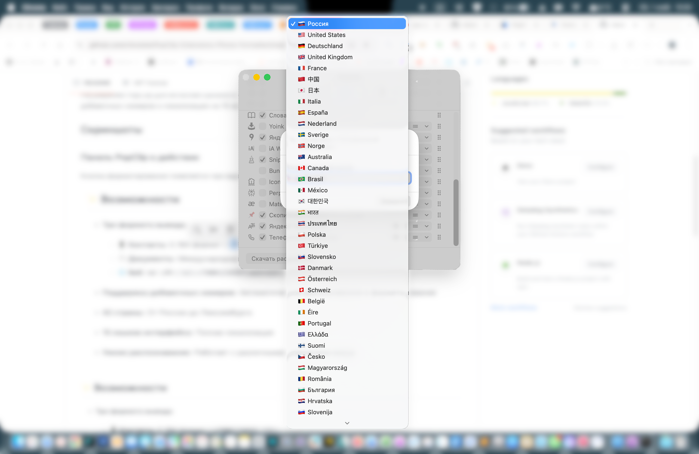
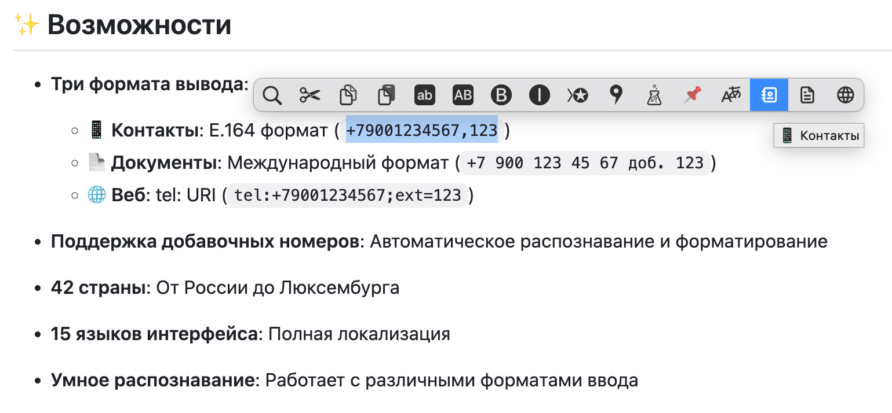

<p align="center">
  <a href="README.md"></a>
  
  
  
</p>

<h1 align="center">📱 PopClip Phone Formatter</h1>

<p align="center">
  <strong>Интеллектуальное форматирование телефонных номеров для macOS</strong><br>
  <sub>42 страны • 16 языков • Добавочные • E.164, E.123, RFC 3966, ГОСТ</sub>
</p>

---

## Возможности

**Четыре формата вывода (подменю):**

| Формат | Результат | Применение |
|--------|-----------|------------|
| 📱 **Контакты** | `+79001234567,123` | Адресные книги, CRM (E.164) |
| 📄 **Документы** | `+7 900 123 45 67 доб. 123` | Письма, документы (E.123) |
| 📋 **ГОСТ** | `+7 (900) 123-45-67, доб. 123` | Документы РФ (ГОСТ Р 7.0.97-2016, только локаль RU) |
| 🌐 **Веб** | `tel:+79001234567;ext=123` | Кликабельные ссылки (RFC 3966) |

**Ключевые функции:**

- ✅ Автоматическое распознавание добавочных (`доб.`, `ext.`, `x`, `#`, `,`, `;`, `Durchwahl`, `poste`, …)
- ✅ Умный парсинг «грязных» форматов (`++`, префикс `00`, кавычки, `Тел:`, `tel:` URI)
- ✅ Форматирование на месте: текст вокруг номера (слова, пунктуация, разделители списка) сохраняется
- ✅ Полноширинные цифры (`８４９５…`) нормализуются перед форматированием
- ✅ Валидация через встроенный `libphonenumber-max.js` (работает офлайн)
- ✅ Проверка вывода перед вставкой: строгий E.164 / RFC 3966
- ✅ Клавиша-модификатор: зажмите **Option (⌥)** на **Документах** для инверсии формата (intl ↔ natl)
- ✅ Переключатели форматов в настройках: оставьте только нужные (E.164, E.123, Веб); если включён один, он показывается сразу кнопкой без подменю. ГОСТ показывается, только если в выделении есть номер РФ
- ✅ Ручной fallback, если встроенная библиотека недоступна или падает (отказ библиотеки окончателен)

## Скриншоты

| Панель настроек | Меню PopClip |
|:---------------:|:------------:|
|  |  |

## Установка

1. Установите [PopClip](https://pilotmoon.com/popclip/) (версия 4200+)
2. Скачайте `phone-formatter.popclipextz` из [Releases](https://github.com/nikolalek/PopClip-Extensions-Phone-Formatter/releases/latest)
3. Дважды кликните для установки
4. Выберите страну по умолчанию в настройках расширения

## Использование

**Базовое:**
1. Выделите любой телефонный номер
2. Наведите на кнопку 📱 и выберите формат из подменю

**Продвинутое:**
- Зажмите **Option (⌥)** при нажатии **Документы** для инверсии формата (intl ↔ natl)
- Пункт **ГОСТ** показывается при стране RU и наличии номера РФ; для остальных стран отсутствует
- Форматы включаются в настройках; если включён один, он показывается без подменю

### Поддерживаемые форматы ввода

| Тип | Пример |
|-----|--------|
| Международный | `+7 (900) 123-45-67` |
| Префикс IDD | `0079001234567` |
| Национальный | `8 (900) 123-45-67` / `(917) 555-1234` |
| Только цифры | `79001234567` |
| С добавочным | `+79001234567 доб. 123`, `+19175551234 ext. 123`, `+442079460958#123` |
| URI формат | `tel:+79001234567;ext=123` |
| Множественные плюсы | `++79001234567` |

### Примеры вывода

| Ввод | Контакты | Документы (intl) | Веб |
|------|----------|------------------|-----|
| `8 900 123 45 67` | `+79001234567` | `+7 900 123 45 67` | `tel:+79001234567` |
| `(917) 555-1234` | `+19175551234` | `+1 917 555 1234` | `tel:+19175551234` |
| `+44 20 7946 0958 x123` | `+442079460958,123` | `+44 20 7946 0958 ext. 123` | `tel:+442079460958;ext=123` |

## Поддерживаемые страны

<details>
<summary><strong>Показать все 42 страны</strong></summary>

> Длина добавочного — 2–6 цифр для любой страны: единый лимит, который применяет форматер.

| Страна | Код | Длина номера | Добавочные |
|--------|-----|--------------|------------|
| 🇷🇺 Россия | +7 | 10 | 1-6 |
| 🇺🇸 США | +1 | 10 | 1-6 |
| 🇬🇧 Великобритания | +44 | 9-11 | 1-6 |
| 🇩🇪 Германия | +49 | 8-11 | 1-6 |
| 🇫🇷 Франция | +33 | 9 | 1-6 |
| 🇨🇳 Китай | +86 | 8, 10-11 | 1-6 |
| 🇯🇵 Япония | +81 | 9-11 | 1-6 |
| 🇰🇷 Южная Корея | +82 | 8-10 | 1-6 |
| 🇧🇷 Бразилия | +55 | 8, 10-11 | 1-6 |
| 🇮🇳 Индия | +91 | 10 | 1-6 |
| 🇦🇺 Австралия | +61 | 9 | 1-6 |
| 🇨🇦 Канада | +1 | 10 | 1-6 |
| 🇲🇽 Мексика | +52 | 10-11 | 1-6 |
| 🇮🇹 Италия | +39 | 9-11 | 1-6 |
| 🇪🇸 Испания | +34 | 9 | 1-6 |
| 🇳🇱 Нидерланды | +31 | 8-9 | 1-6 |
| 🇵🇱 Польша | +48 | 8-9 | 1-6 |
| 🇹🇷 Турция | +90 | 10 | 1-6 |
| 🇹🇭 Таиланд | +66 | 8-9 | 1-6 |
| 🇸🇪 Швеция | +46 | 7-9 | 1-6 |
| 🇳🇴 Норвегия | +47 | 8 | 1-6 |
| 🇩🇰 Дания | +45 | 8 | 1-6 |
| 🇫🇮 Финляндия | +358 | 8-9 | 1-6 |
| 🇦🇹 Австрия | +43 | 8-13 | 1-6 |
| 🇨🇭 Швейцария | +41 | 9 | 1-6 |
| 🇧🇪 Бельгия | +32 | 8-9 | 1-6 |
| 🇮🇪 Ирландия | +353 | 8-9 | 1-6 |
| 🇵🇹 Португалия | +351 | 9 | 1-6 |
| 🇬🇷 Греция | +30 | 10 | 1-6 |
| 🇨🇿 Чехия | +420 | 9 | 1-6 |
| 🇭🇺 Венгрия | +36 | 8-9 | 1-6 |
| 🇷🇴 Румыния | +40 | 9 | 1-6 |
| 🇧🇬 Болгария | +359 | 8-9 | 1-6 |
| 🇭🇷 Хорватия | +385 | 8-9 | 1-6 |
| 🇸🇮 Словения | +386 | 8 | 1-6 |
| 🇸🇰 Словакия | +421 | 9 | 1-6 |
| 🇱🇹 Литва | +370 | 8 | 1-6 |
| 🇱🇻 Латвия | +371 | 8 | 1-6 |
| 🇪🇪 Эстония | +372 | 7-8 | 1-6 |
| 🇨🇾 Кипр | +357 | 8 | 1-6 |
| 🇲🇹 Мальта | +356 | 8 | 1-6 |
| 🇱🇺 Люксембург | +352 | 8-9 | 1-6 |

</details>

## Локализация

Интерфейс доступен на 16 языках:

> English, Русский, Deutsch, Français, 中文, 日本語, Italiano, Español, Nederlands, Polski, Português (BR), 한국어, Tiếng Việt, Türkçe, Slovenčina, Dansk

## Технические детали

<details>
<summary><strong>Архитектура</strong></summary>

```
Ввод → Очистка и парсинг добавочного → libphonenumber-max (встроен, офлайн)
                                              ↓
                                         isValid()?
                                         ┌────┴────┐
                                        YES        NO → отклонить
                                         ↓
                                   Формат E.164
                                         ↓
                        Формат по типу (contact/document/gost/web)
                                         ↓
                          Проверка спеки (E.164 / RFC 3966) → Добавить extension
```

**Логика валидации:**
1. Очистка ввода (удаление мусора, `+++` → `+`, `00` → `+` с проверкой через lib)
2. Парсинг через встроенный `libphonenumber` (страна из `+CC`, фикс транка `8`/`7` для RU/KZ)
3. Если распознано, но `isValid() = false` → отклонить (ручной fallback используется, только если встроенная библиотека недоступна)
4. Форматирование по типу; строгая проверка для `contact`/`web`

**Тесты:** `make test` запускает `test/phonefmt.test.js` — рандомизированная проверка по 42 доступным странам (E.164 сверяется с библиотекой, E.123/ГОСТ и национальный формат точно, RFC 3966 по форме).

</details>

<details>
<summary><strong>Зависимости</strong></summary>

- **Runtime**: `libphonenumber-max.js` (встроенный IIFE, ~280 КБ, офлайн)
- **Обновления**: `make check-lib` — встроенная vs последняя версия; `make update-lib` — пересборка бандла из npm при устаревании
- **Платформа**: PopClip 4200+
- **ОС**: macOS 11+

</details>

## Участие в разработке

1. Форкните репозиторий
2. Создайте ветку функции (`git checkout -b feature/amazing-feature`)
3. Зафиксируйте изменения (`git commit -m 'Add amazing feature'`)
4. Отправьте в ветку (`git push origin feature/amazing-feature`)
5. Откройте Pull Request

## Сообщение об ошибках

Нашли ошибку? Пожалуйста, [создайте issue](https://github.com/nikolalek/PopClip-Extensions-Phone-Formatter/issues) с указанием:

- Входящий номер телефона
- Ожидаемый результат
- Фактический результат
- Версия PopClip

## История изменений

### v2.7.0

**Исправления:**
- Форматирование больше не выбрасывает текст вокруг номера: `Звонить 84951234567 сегодня` → `Звонить +74951234567 сегодня`; разделители списка сохраняются как в исходнике (`/`, `;`, `,`)
- Пункт ГОСТ скрывается, если в выделении нет номера РФ; раньше иностранный номер при стране RU показывал нерабочий пункт
- Полноширинные цифры (`８４９５…`) нормализуются (NFKC) до разбора
- Списки с добавочными больше не теряют первый номер (`84951234567 ext. 12, 84957654321` форматирует оба)
- Скобки вокруг номера поглощаются парой, а не удаляются наполовину
- Меню показывается только когда выделение действительно форматируется: даты, время и IP больше не дают нерабочих пунктов; точечные номера (`8495.123.45.67`) снова видны
- Пробелы, отступы и переводы строк CRLF вокруг номеров сохраняются как набраны
- Корейский `내선` и тайский `ต่อ` распознаются, поэтому документный вывод разбирается обратно; ключи локалей исправлены на `pt-BR` / `zh-Hans`
- Ручной fallback: добавочные в скобках и однозначные работают, номера США с ведущей `1` отклоняются
- Все виды скобок (`[]`, `{}`, `()`) вокруг добавочного обрабатываются одинаково: `[84951234567 ext. 12]` больше не скрывает меню, `{…}` не оставляет скобки в выводе
- Добавочный в голых скобках (`8 495 123-45-67 (123)`) распознаётся и в библиотечном, и в ручном пути
- Лишний `+` внутри номера (`+7+4951234567`) убирается, а не проходит насквозь; пробел перед номером сохраняется

**Инструменты:**
- Включён `strict` в typecheck (`noImplicitAny` пока выключен — в JS нет аннотаций)
- `make jsc` запускает Config.js в настоящем JavaScriptCore; новая macOS-джоба в CI
- Тесты: 689 проверок × 3 сида + 59 проверок fallback; детерминированная выборка стран с общими кодами (+7 RU/KZ, +1 US/CA), тесты границ добавочного и guard вывода

## Лицензия

[MIT](LICENSE) © nikolalek

---

<p align="center">
  <sub>Сделано с ❤️ для сообщества PopClip</sub>
</p>
